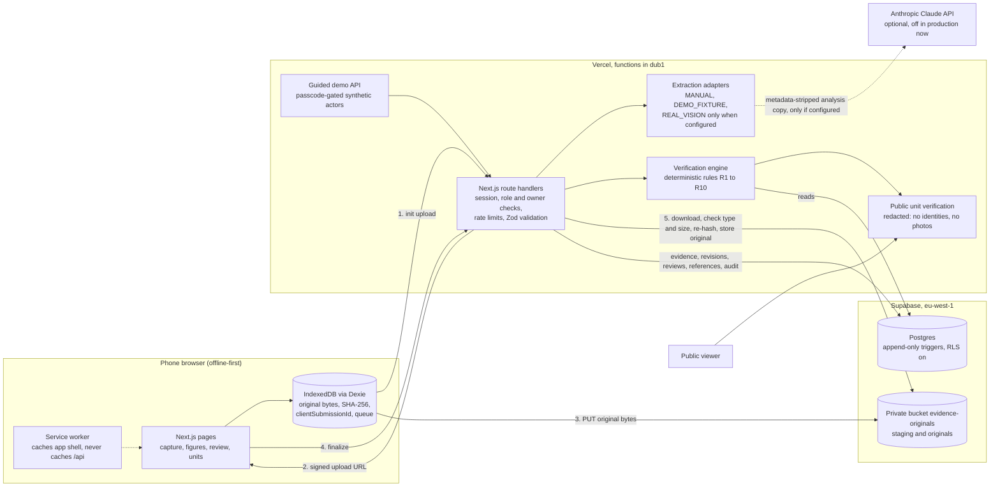

# PollTrace

**Keep the photo. Trace the record.**

PollTrace is an offline-first web app. Voters, party agents and observers in Nigeria use it to photograph the polling-unit result sheet posted in public. The app keeps the original photo safe on the phone with no network, uploads it unchanged later, and helps reviewers compare the figures with other records. It explains every difference and makes no accusations.

| | |
|---|---|
| **Live app** | https://polltrace.vercel.app |
| **Guided demo** | https://polltrace.vercel.app/demo (see [Guided demo](#guided-demo-demo)) |
| **Public comparison example** | https://polltrace.vercel.app/units |
| **Code** | https://github.com/ktechfest2/TEAM-20-3.0 |

> **ALL DATA IN THIS BUILD IS SYNTHETIC.** The election, the polling units (codes start with `DEMO.`), the parties (`PARTY_A`, `PARTY_B`, `PARTY_C`), the reviewers and the result sheets are made up for testing. Every screen shows a **DEMO DATA** band that cannot be closed.
>
> **PollTrace is not affiliated with INEC (Nigeria's Independent National Electoral Commission).** It does not run, certify or verify elections. It does not replace Form EC8A or official collation. It makes no claims about any real election, party, polling unit or person.

---

## Contents

1. [Problem brief](#1-problem-brief)
2. [How it works](#2-how-it-works)
3. [Architecture](#3-architecture)
4. [Data model](#4-data-model)
5. [API](#5-api)
6. [Security and privacy](#6-security-and-privacy)
7. [Run locally and test](#7-run-locally-and-test)
8. [Verified results](#8-verified-results)
9. [Three-minute demo video plan](#9-three-minute-demo-video-plan)
10. [Known limitations](#10-known-limitations)
11. [Original work](#11-original-work)
12. [AI use](#12-ai-use)
13. [Attribution and licences](#13-attribution-and-licences)

---

## 1. Problem brief

**The weak link.** Polling-unit results are posted in public. But no one keeps the posted results together in a way people can check, or compares them with reference records that appear later.

**The problem.** Voters, agents and observers take photos of the posted result sheet. These photos end up on many phones. Poor networks delay them. People find them hard to read, cross-check or attribute. A screenshot can be mislabelled, duplicated or changed. A difference between two records may be a copying mistake, not wrongdoing. Without the original image and a history of every correction, people cannot look into a disagreement responsibly.

**Who is affected.**
- Voters who want to check the figures posted at their polling unit.
- Observers and party agents who keep photos as evidence.
- Journalists and civil-society groups who look into differences.
- Administrators who must answer specific, documented questions.

**The solution.** PollTrace captures the original photo offline. It saves a fingerprint and a receipt on the phone right away. When the network returns, the photo goes to private storage, and the server checks the fingerprint again. A person enters or confirms every figure. Reviewers record their decisions. A fixed set of rules then compares the reviewed records with a reference record and explains the result in plain words.

**What makes it different: ProofTrail.** ProofTrail is the inspectable chain behind each record: image integrity, claims about the source, human corrections, review decisions and differences. It is not a dashboard of totals. It always states three truths:

| PollTrace shows | It does **not** mean |
|---|---|
| The fingerprint (SHA-256 hash) matches | The photo is real or the result is true. It only means the file arrived unchanged. |
| Several photos show the same figures | Several independent witnesses. Copies of one photo count once, and only a reviewer can confirm independence. |
| A record differs from the reference | Fraud. A difference is a question to check, not an allegation. |

**Outcome.** Evidence is easier to inspect, and disagreements become specific questions that someone can investigate. PollTrace does not certify election outcomes.

---

## 2. How it works

The demo story has eight steps. All of them run on the live app with synthetic data.

| # | Step | What happens | Where in the code |
|---|---|---|---|
| 1 | **Offline capture** | Pick the polling unit (state → LGA → ward → code) and take or choose a photo. Works with no network once the app has loaded once (service worker cache). | `src/app/capture`, `public/service-worker.js` |
| 2 | **Local receipt** | Before it shows success, the browser saves the original bytes, a SHA-256 fingerprint (Web Crypto) and a stable `clientSubmissionId` in IndexedDB (Dexie). The receipt survives a page refresh. | `src/lib/offline` |
| 3 | **Upload and server re-hash** | When online, the app asks for a signed upload URL and sends the bytes straight to private storage. The server then downloads them, checks the file type and size, computes the SHA-256 again, and stores that same checked buffer as the original. If the hashes differ, nothing is stored. A retry with the same `clientSubmissionId` returns the same receipt; it never creates a duplicate. | `src/lib/evidence/uploads.ts`, `service.ts` |
| 4 | **Human-confirmed figures** | The submitter types the figures (**MANUAL**). On synthetic evidence only, they can load fixed, clearly labelled demo figures (**DEMO_FIXTURE**, "Demo figures — not read from this photo"). Claude vision extraction (**REAL_VISION**) is implemented, but it appears only when the server is configured for it. At the time of writing, production is not (see [AI use](#12-ai-use)). AI output is only ever a suggestion: the submitter checks and confirms every figure. Each confirmation is a new revision, and older revisions are kept. | `src/lib/extraction`, `src/app/evidence/[id]/figures` |
| 5 | **Reviewer decision and independence** | A reviewer (a different account) accepts, rejects or flags the evidence, gives a reason, and marks independence as `UNVERIFIED`, `REVIEWER_CONFIRMED` or `DISPUTED`. Reviewers cannot review their own evidence. They cannot accept evidence until the submitter has confirmed its figures. | `src/lib/evidence/workflow.ts`, `src/app/review` |
| 6 | **Second-reviewer source check** | A reviewer imports a versioned reference record (here a `SYNTHETIC_DEMO` reference). A **different** reviewer must check its source before it counts. The importer is blocked (`403 SELF_REVIEW`). | `src/lib/references`, `src/app/units/[id]/references` |
| 7 | **Deterministic comparison** | Rules R1–R10 group records by polling unit, count copies of one photo once, require two reviewer-confirmed independent sources, and compare them with the reference. No AI is involved. Synthetic example: witness Party B = 210, reference = 270, so the difference is **+60** (reference minus witness). | `src/lib/verification` |
| 8 | **Public comparison and "why no allegation"** | A public page shows the status, the key difference first ("Reference is 60 higher"), and a section called **"Why no allegation is made"**. It shows no names and no photos. | `src/app/units/[id]` |

### Guided demo (`/demo`)

`/demo` is a presenter page that walks through the eight steps. Steps 1–3 link to the real capture, submissions and figures screens. Steps 4–7 are buttons that the presenter triggers with a server-side admin passcode. Each button runs the **real services**, the same ones the API routes use, acting as fixed **synthetic actors** on the demo unit `DEMO.00.00.012`. It is not a simulation or a mock-up. Every result on the page comes from the server.

| Step | Button | What it runs |
|---|---|---|
| 4 | "Run: two witnesses submit" | Synthetic Demo Witness 1 and 2 upload two different synthetic sheets (real upload, file-signature check and server re-hash). They load demo figures and confirm Party A 145 / B 210 / C 42. |
| 5 | "Run: a copy is sent" | Synthetic Demo Witness 3 uploads an exact copy of Witness 1's file (same SHA-256), which is counted once. |
| 6 | "Run: reviewer decides" | Synthetic Demo Reviewer A accepts all three. Witnesses 1 and 2 are marked independent. The copy is left "not assessed". |
| 7 | "Run: reference added and checked" | Synthetic Demo Reviewer B imports a `SYNTHETIC_DEMO` reference (145 / 270 / 42), and Reviewer A (a different reviewer) confirms its source. |
| — | "Reset demo scenario" | Calls `reset_demo_scenario` (migration 0007). It deletes **only** rows created by the synthetic demo actors on the demo unit. Anyone else's evidence, including a presenter's live capture, is never touched. |

Seen on production on 2026-11-20: the steps took 3.6 s, 2.3 s, 1.6 s and 1.3 s. The status went `PENDING_REVIEW` → `CORROBORATED` → `REFERENCE_DISCREPANCY`, with Party B 270 vs 210 = **+60**. The copy was excluded as "Exact copy of another photo — counted once", the passcode never appeared in responses, a wrong passcode returned `401`, and reset returned the unit to `NO_EVIDENCE`.

Comparison statuses, in order of precedence: `NO_EVIDENCE` → `PENDING_REVIEW` / `INCONCLUSIVE` → `CONFLICTING_EVIDENCE` → `REFERENCE_DISCREPANCY` → `CORROBORATED` → `MATCHING_SUBMISSIONS` → `INCONCLUSIVE`. A reference difference is marked "unconfirmed" until the reference source is reviewed **and** there are at least two independent sources.

---

## 3. Architecture

A modular monolith: one Next.js app, one Postgres database, one private storage bucket. There are no queues, microservices or blockchain.



Notes:
- Without Supabase settings, the server uses a **LOCAL_DEV** store (JSON and files in `./.data/`). API responses say `storageMode: "LOCAL_DEV"`. In production, the server refuses this store unless `POLLTRACE_ALLOW_LOCAL_STORE=1` is set on purpose.
- A multipart `POST /api/evidence` path stays as a fallback for small files.
- Fonts are loaded with `next/font/google`, which self-hosts them at build time.

---

## 4. Data model

The schema is in `supabase/migrations/` (Postgres). Row-level security (RLS) is on for every table. Only the election and polling-unit registry can be read with the public key. All writes go through server route handlers that use the service role.

| Table | What it holds | Write rules |
|---|---|---|
| `elections` | The election (one synthetic election, `demo-election`) | Seeded, `synthetic = true` |
| `polling_units` | Registry: state, LGA, ward, code, name; unique per (registry source, code) | 7 synthetic units seeded (`DEMO.…`), `synthetic = true` |
| `contributors` | Opaque contributor or reviewer record: alias, role (`CONTRIBUTOR`/`REVIEWER`), assurance level | Anonymous contributors have no phone, email or location. The demo reviewers are marked synthetic. |
| `evidence` | One uploaded original: private storage path, SHA-256, MIME type, size, unit, source type claim, claimed capture time, received time, `synthetic` | Unique (contributor, `client_submission_id`). A trigger blocks any change to the hash, path, size, submission id or contributor. |
| `result_revisions` | Each reading of the figures: number, origin (`MANUAL`, `DEMO_FIXTURE`, `HUMAN_CORRECTION`, `REAL_VISION`), form type, totals, `human_confirmed`, `based_on_revision` | **Append-only** (trigger). Written together with its entries in one transaction by a service-role-only function (0005). |
| `result_entries` | Per-party votes for a revision (`null` = unreadable), `needs_review` | **Append-only** |
| `review_events` | Reviewer decision (`ACCEPTED`/`REJECTED`/`FLAGGED`), independence assessment, reason (min. 3 characters) | **Append-only**. Evidence status comes from the latest decision. |
| `reference_results` | Versioned reference figures with source type (`MANUAL_IREV`, `HISTORICAL_DATASET`, `SYNTHETIC_DEMO`), description, optional URL, `synthetic` | **Append-only**. A new version is a new row. |
| `reference_reviews` | Second-reviewer source check (`SOURCE_CONFIRMED`/`SOURCE_REJECTED`) and reason (0006) | **Append-only**. "Source verified" means the provenance was reviewed. It never means INEC-verified. |
| `audit_events` | Event log per evidence item (received, extracted, confirmed, reviewed, …) | **Append-only** |

Status is worked out from event history (latest review, latest human-confirmed revision, latest reference review), not edited in place. The comparison itself is computed on each request and is not stored.

`supabase/admin/` holds a one-time, documented reset script for synthetic demo data.

Migration `0007_demo_scenario_reset.sql` is **applied** to the live database. It adds `reset_demo_scenario`, used by the guided demo's reset. This is the **only exception** to append-only:
- A DELETE (never an UPDATE) is allowed only while a transaction-local setting is on, and only this function turns it on.
- Only the service role may run the function.
- It refuses non-synthetic units, actors, evidence and references.

Per the status log, the lead checked after applying it that the anonymous role cannot run the function and that the 7 append-only triggers are still enabled. Every reset is also written to the audit log.

---

## 5. API

All bodies are checked with Zod. Errors return a stable `code` (for example `SELF_REVIEW`, `HASH_MISMATCH`, `STALE_REVISION`). "Owner" means the contributor whose signed session uploaded the evidence. Anyone else who asks for evidence they may not see gets `404`, not `403`, so evidence IDs cannot be probed.

| Route | Who may call it | Purpose |
|---|---|---|
| `GET /api/elections` | Public | Synthetic election list (labelled) |
| `GET /api/polling-units?search=` | Public | Search the synthetic registry |
| `GET/POST/DELETE /api/session` | Anyone (new sessions: 10/min per IP) | Read the session, create an anonymous **contributor** session (role cannot be chosen), or sign out |
| `POST /api/session/demo-reviewer` | Only when `POLLTRACE_DEMO_REVIEWERS=1`; production also needs a server-side passcode | Sign in as "Synthetic Demo Reviewer A" or "B" |
| `POST /api/evidence/uploads` | Contributor (reviewers get `403 REVIEWER_SESSION`) | Start a direct upload: returns a signed staging URL and a signed intent token. Size is checked up front. |
| `PUT /api/evidence/uploads/local/[token]` | Holder of a valid grant, **LOCAL_DEV only** | Local stand-in for the Supabase signed URL |
| `POST /api/evidence/uploads/finalize` | Contributor | Server downloads the staged bytes, checks file signature and size, re-hashes, stores the original, creates the evidence record and audit event. Idempotent. |
| `POST /api/evidence` | Contributor | Multipart fallback upload with the same checks |
| `GET /api/evidence/[id]` | Owner or reviewer | Evidence record and receipt |
| `GET /api/evidence/[id]/original` | Owner or reviewer | Original bytes, proxied, `Cache-Control: private, no-store` |
| `POST /api/evidence/[id]/extract` | **Owner only** (reviewers get `403 OWNER_ONLY`) | Create a draft revision: MANUAL, DEMO_FIXTURE (synthetic evidence only), or REAL_VISION when configured (max 3 AI attempts per photo, one at a time; every attempt and failure is audited) |
| `POST /api/evidence/[id]/confirm` | Owner only | Confirm or correct figures. Creates a new human revision. Fails with `409 STALE_REVISION` if the figures changed. |
| `POST /api/evidence/[id]/review` | Reviewer, not the owner | Append a decision with reason and independence |
| `GET /api/evidence/[id]/trace` | Owner or reviewer | ProofTrail: receipt, all revisions, reviews and timeline |
| `GET /api/review/queue` | Reviewer | Evidence waiting for review |
| `POST /api/references` | Reviewer | Import a versioned reference. `sourceUrl` is stored as text and **never fetched**. |
| `POST /api/references/[id]/review` | Reviewer who did not import it | Confirm or reject the reference's source |
| `GET /api/units/[id]/references` | Reviewer | References and their source reviews for a unit |
| `GET /api/units/[id]/verification` | **Public**, 60 requests/min per IP | Comparison result. Redacted: no contributor IDs, aliases or storage paths, and no photos. |
| `GET /api/demo` | Public (no secrets) | Guided-demo state: which steps are done, the IDs they created, and the current comparison status |
| `POST /api/demo/stages/[stage]` | Anyone holding the server-side admin passcode | Run one guided-demo step (`WITNESSES`, `DUPLICATE`, `REVIEWS`, `REFERENCE`) in order, as synthetic actors |
| `POST /api/demo/reset` | Admin passcode | Scoped reset of the synthetic demo actors' rows on the demo unit |

---

## 6. Security and privacy

This section lists only what the code does. Gaps are listed in [Known limitations](#10-known-limitations).

**Roles and sessions**
- The session is a signed (HMAC-SHA256), `HttpOnly`, `SameSite=Lax` cookie (`Secure` in production) that holds only a contributor ID. Production refuses to start without a secret of at least 32 characters.
- The role lives on the server. A browser can never pick a role. Demo reviewer sign-in is off unless it is switched on, and production also needs a passcode (compared in constant time).
- Reviewers cannot review their own evidence, and the importer of a reference cannot check its source (`403 SELF_REVIEW`). Reviewer sessions cannot upload (`403 REVIEWER_SESSION`). Only the owner can confirm figures (`403 OWNER_ONLY`). Reviewers cannot accept evidence without confirmed figures (`409 NO_CONFIRMED_REVISION`).

**Integrity**
- The SHA-256 is computed in the browser and again on the server from the bytes the server actually stored. If they differ, the server returns `422 HASH_MISMATCH` and stores nothing.
- Staged bytes are never trusted. The server writes the same buffer it checked, so a re-upload to the staging URL after the check cannot be promoted.
- Idempotency: the same `clientSubmissionId` with the same bytes returns the same receipt. Different bytes return `409`.
- The original-file fields are immutable, and revisions, reviews, references, reference reviews and audit events are append-only (database triggers).

**Files**
- The file type comes from the magic bytes (JPEG, PNG, WebP), not from the declared MIME type or file name. Images are never decoded on the server, so there is no decompression-bomb risk.
- 15 MB cap, enforced at upload start, on the stored object, and by the bucket itself. Original bytes are never resized.

**Privacy**
- Storage bucket `evidence-originals` is private. Originals are served only to the owner or a reviewer through a no-store proxy. No public or long-lived URL is issued.
- The public comparison is redacted. It shows no contributor IDs, aliases, references or storage paths, and no photos. It does show evidence IDs and file fingerprints.
- When AI reading is configured and the submitter chooses it, only a temporary **analysis copy** is sent to Anthropic. It is rotated, shrunk and re-encoded, and **all metadata (EXIF/GPS) is stripped**. The original bytes are never changed or sent, and the copy has its own fingerprint, which is never confused with the original's. The figures screen tells the submitter "Your photo is sent to an outside AI service to be read."
- No GPS, phone number, face recognition or device fingerprinting is collected.

**Other**
- Reference `sourceUrl` is never fetched by the server, so there is no SSRF risk (a unit test spies on `fetch`).
- Model or vision output is never trusted. The image is treated as data, so text on the sheet cannot change the instructions. The model's answer must pass strict Zod schemas and range checks, unreadable values stay `null` and are flagged, and every figure needs human confirmation. AI calls time out after 45 s.
- Secrets (Supabase service key, session secret, passcodes, Anthropic key) are read only in `server-only` modules. Only `NEXT_PUBLIC_SUPABASE_URL` reaches the browser. A search of an earlier local build's client chunks for the secret variable names found none. This is a spot check, not a formal audit.
- Rate limits (in memory, per server instance):
  - Uploads: 30/min.
  - Workflow writes: 60/min.
  - Extraction: 10/min.
  - Public verification: 60/min per IP.
  - New sessions: 10/min per IP.
  - Passcode lockout (demo admin and demo reviewer): 5 wrong tries per IP and 30 in total per minute.
  - The client IP comes from Vercel's edge header. Otherwise the server uses the right-most `X-Forwarded-For` hop, which a client cannot spoof.

**Adversarial QA (2026-11-20)**

A separate QA agent attacked a local build and probed production lightly. Many attacks held: idempotency, hash tampering, duplicate inflation, access control, SSRF, redaction and RLS. It found the issues below. The fixes are in commit `11a0aca`, with tests. At `ec29903`, `npm test` gives **388 passed, 4 skipped** (opt-in smoke tests). That run was on 2026-11-20 and only the README had changed locally. The fixes have not been re-attacked yet.

| Severity | Finding | Status |
|---|---|---|
| HIGH | A newer, unreviewed reference version could hide a confirmed discrepancy | **Fixed**: the comparison uses the latest *source-confirmed* version, so an unreviewed newer version cannot displace it |
| MED | A sheet whose polling-unit code differs from the unit could still be accepted | **Fixed**: `409 PU_CODE_MISMATCH`, so the reviewer must flag or reject it |
| MED | No rate limits on public verification or new sessions | **Fixed**: per-IP limits (see above) |
| MED | No lockout on the demo reviewer passcode | **Fixed**: per-IP and global lockout |
| MED | Rate-limit IP could be spoofed with `X-Forwarded-For` | **Fixed**: Vercel header, or the right-most hop |
| LOW | A malformed session cookie caused a 500 | **Fixed**: treated as no session |
| — | Reviewers could run extraction on others' photos | **Changed**: extraction is owner-only, with an AI attempt cap and lock |
| LOW | Evidence IDs and fingerprints appear in the public view; a replayed upload ignores changed metadata; no CSRF token beyond `SameSite=Lax`; no extra security headers; stateless sessions cannot be revoked | **Open** (accepted for the MVP) |

---

## 7. Run locally and test

Requires Node 24 (tested with 24.18.1) and npm.

```bash
npm install
cp .env.example .env.local   # everything is optional for local development
npm run dev                  # http://localhost:3000
```

With no Supabase settings, uploads go to the **LOCAL_DEV** store in `./.data/` (gitignored). To use Supabase, set `NEXT_PUBLIC_SUPABASE_URL` and `SUPABASE_SERVICE_ROLE_KEY` (server-only), and apply `supabase/migrations/0001`–`0007` in order. To try the reviewer screens locally, set `POLLTRACE_DEMO_REVIEWERS=1`. For the guided demo, also set `POLLTRACE_DEMO_ADMIN_PASSCODE`. For Claude vision, set `VISION_PROVIDER=anthropic` and `ANTHROPIC_API_KEY` (optionally `VISION_MODEL`). All of these are server-only.

| Command | What it does |
|---|---|
| `npm run typecheck` | `tsc --noEmit` (strict) |
| `npm run lint` | ESLint |
| `npm test` | Vitest unit and route tests. Supabase smoke tests are skipped unless `POLLTRACE_SUPABASE_SMOKE=1`. |
| `npm run build` | Production build |
| `npm run e2e` | Playwright on a 360 px phone viewport. Local runs start `next dev` on port 3100 with an **isolated LOCAL_DEV store in a temp folder**. Supabase settings are blanked, so tests never touch shared data. |

Opt-in E2E variants:
- `POLLTRACE_E2E_SUPABASE=1 npm run e2e` runs locally against the Supabase project in `.env.local`.
- `POLLTRACE_E2E_LARGE=1` adds the ~12 MB direct-upload test.
- `POLLTRACE_E2E_BASE_URL=https://polltrace.vercel.app POLLTRACE_E2E_REVIEWER_PASSCODE=… npm run e2e` runs against a deployment. Automated tests use reserved units `demo-pu-101` and `demo-pu-201`. They never use the live demo unit `demo-pu-012`.

---

## 8. Verified results

These results were copied from the project's status log. They are what was actually seen, with dates (all times UTC+1). Nothing here was re-run while writing this README.

| Date | Check | Result |
|---|---|---|
| 2026-11-20, commit `913935d` | `npm run typecheck` / `npm run lint` / `npm run build` | 0 errors / clean / clean |
| 2026-11-20, `913935d` | `npm test` (Vitest) | **301 passed, 3 skipped** (opt-in Supabase smoke tests) |
| 2026-11-20, `ec29903` | `npm test` (Vitest, run while writing this README) | **388 passed, 4 skipped** (opt-in Supabase and live-vision smoke tests) |
| 2026-11-20 | Guided demo on production (real Supabase) | 4 steps in 3.6 / 2.3 / 1.6 / 1.3 s; `PENDING_REVIEW` → `CORROBORATED` → `REFERENCE_DISCREPANCY`; Party B **+60**; copy "counted once"; wrong passcode `401`; reset → `NO_EVIDENCE` |
| 2026-11-20, `913935d` | Playwright **against production** | **4 of 4 passed**, 1 skipped (12 MB opt-in): capture, review flow, unit finder, two witnesses + second-reviewer reference → "differs from reference" **+60** |
| 2026-11-20 | Offline PWA regression on production | **Pass** |
| 2026-11-19 | Offline regression on production (service worker) | Service worker ready → offline reload shows `/capture` → capture saved offline → survives offline reload → reconnect syncs automatically → **exactly one** finalize `201` |
| 2026-11-19 | 14.01 MB browser upload on production | Received in **10.9 s** (init 0.4 s, direct PUT to Supabase 6.0 s, finalize 2.5 s); integrity confirmed. Function memory not measured. |
| 2026-11-19 | ~12 MB direct upload, local machine → Supabase | Passed once (~55 s). A second run finished on the server after the test timeout (limited by the local uplink). |
| 2026-11-19 | Supabase smoke on `demo-pu-102` | `CORROBORATED` → reference imported, not reviewed (still `CORROBORATED`, difference unconfirmed) → second reviewer confirms source → `REFERENCE_DISCREPANCY`, Party B **+60** |
| 2026-11-19 | Public key access check | Evidence and audit reads return empty; originals cannot be downloaded (HTTP 400); registry readable |
| 2026-11-19 | Append-only triggers | Verified on the live database (and checked again after the 2026-11-20 data reset) |
| 2026-11-19 / 20 | Design review (Impeccable critique and audit, screenshots at 360/390/768/1280 px, 200 % zoom) | Issues found and fixed. The final polish was **not** re-checked. |

---

## 9. Three-minute demo video plan

Every number is synthetic, and the DEMO DATA band stays visible all the time. Steps 1–4 are done live by the presenter. The witness, copy, review and reference steps are triggered by the presenter on `/demo`, which runs the real services as fixed synthetic actors. Figures come from the labelled demo figures and are never presented as AI.

| Time | Step | What the viewer sees |
|---|---|---|
| 0:00–0:15 | Hook | Home page with the DEMO DATA band. "Photos of posted results get scattered, delayed and copied. Everything here is synthetic; this is not INEC." |
| 0:15–0:45 | 1–2 Offline capture and local receipt | Network off. Capture on `DEMO.00.00.012` with the synthetic sample sheet, then "Save this photo". The receipt shows "Saved on this device", the fingerprint and the receipt number. Reload: the receipt is still there. |
| 0:45–1:05 | 3 Upload and server re-hash | Network on. Auto-upload gives "Received by server" and "Source integrity confirmed. The server's fingerprint matches yours.", plus "It does not show the result sheet itself is genuine." |
| 1:05–1:25 | 4 Human-confirmed figures | "Read the figures", then "Load demo figures" ("Demo figures — not read from this photo"; AI reading is off in production). Check against the photo, then "Confirm figures". The draft and the confirmation are separate revisions. |
| 1:25–1:45 | 5 Two witnesses and a copy | `/demo`: "Run: two witnesses submit", then "Run: a copy is sent". Same fingerprint, so the copy is counted once: three photos are not three witnesses. |
| 1:45–2:05 | 6 Reviewer judges independence | "Run: reviewer decides". The status becomes "Corroborated" only after a reviewer judges independence. |
| 2:05–2:25 | 7 Second-reviewer source check | "Run: reference added and checked". B imports the reference and A (a different reviewer) checks its source. The status becomes "Differs from reference". |
| 2:25–2:50 | 8 Public comparison | `/units/demo-pu-012`: Party B "+60", "Reference is 60 higher", "Why no allegation is made", with no names or photos. |
| 2:50–3:00 | Close | "PollTrace doesn't declare fraud. It keeps the evidence behind a difference open to inspection." |

---

## 10. Known limitations

- **AI reading has only been tested on synthetic, printed-style sheets.** Live Claude extraction runs in production (see §12), but accuracy on real handwritten EC8A forms, poor light or angled photos has not been measured. Every AI value must still be checked and confirmed by a person.
- **Demo reviewer identities instead of real sign-in.** Reviewers are "Synthetic Demo Reviewer A/B", protected by a shared passcode in production. Contributors are anonymous cookie sessions. There are no real accounts or verified identities, and the source type is the submitter's own claim.
- **Rate limits are in memory, per server instance.** On Vercel they reset on cold start, so they add friction but are not a quota.
- **Abandoned staging uploads are not cleaned up.** They stay private and are never promoted.
- **Not every status has been seen on screen.** `PENDING_REVIEW`, `MATCHING_SUBMISSIONS`, `CORROBORATED`, `CONFLICTING_EVIDENCE` and `INCONCLUSIVE` are covered by unit tests. Only the no-evidence and reference-discrepancy paths were checked in the browser.
- **Reference HTTP routes** were tested only on the LOCAL_DEV store. Their service functions were smoke-tested on Supabase.
- **No real-device or screen-reader test yet.** Phone behaviour was checked with Playwright phone emulation (360 px).
- **Not installable yet.** There is no web app manifest. Offline use comes from the service worker after one online visit, and the service worker registers only in production builds.
- **The registry is synthetic only.** There is no historical or official data and no IReV integration.
- **Exact duplicates only.** Copies with identical bytes are found. Re-saved, cropped or resized copies of the same photo are not.
- **English only.** Hausa (and other languages) are not done. Text is written inline in components.
- **Not built:** case pages (`/cases/[id]`, `GET /api/cases/:id`), a public evidence page, PDF export, EXIF-stripped public images.
- **Guided `/demo` reset is scoped to the synthetic demo actors.** A presenter's own live capture on the demo unit is never removed, so it stays listed as "not counted" until the one-time admin reset is run. The demo actors and reviewers are synthetic, and the steps are triggered by the presenter, not by real people.
- The full demo story (live capture plus guided steps) has not yet been recorded end-to-end in one take.
- The 15 MB limit was measured on production at 14 MB, but function memory was not measured.

---

## 11. Original work

PollTrace was written during the hackathon. The first commit is dated 2026-11-19 22:18 (UTC+1), and the full history is in this repository. No code from an existing project was imported. Repositories listed during research (for example community 2023 election datasets) were read for background only. No code or data from them is in this repository. The few default SVG icons in `public/` come from the `create-next-app` template. The third-party libraries listed below are used under their own licences.

---

## 12. AI use

**While building:** PollTrace was built with **Claude Code (Anthropic)**, using the model **Opus 5.5**, as a coding assistant with sub-agents (backend, offline UX, extraction/verification, design review, QA, release). Design reviews used the Impeccable design skill inside Claude Code. People on the team chose the product and security direction, made the decisions, and reviewed the work.

**When the app runs:** Claude vision extraction is implemented (`src/lib/extraction/anthropic.ts`, Anthropic SDK, default model `claude-opus-5-5`, configurable). It is **switched on in production** (`VISION_PROVIDER=anthropic`, key stored only as a server-side Vercel environment variable). Verified 2026-11-20:
- Live smoke test (local, real API) on the synthetic sheet: read 145 / 210 / 42, total valid 397 and the polling-unit code exactly; returned **null and flagged uncertain** for accredited and rejected voters, which are not on the sheet (no invented numbers); 5.1 s.
- Live browser E2E on production: upload → AI reading → person changes one value and ticks uncertain fields → confirms → reviewer accepts → ProofTrail shows the AI version with provenance and the person's change; the stored original's SHA-256 still equals the uploaded file.
- Production extraction latency: 7.2 s and 4.6 s (2 runs, 0 failures). A run on a sheet printed with a different unit code correctly showed the mismatch and blocked acceptance.
- No key material in 8 production pages / 16 JS bundles, nor in stored extraction records.

When no key is configured, the figures screen says "Automatic reading is not available right now. Figures are typed in by a person."

When AI reading is switched on:
- It is shown as "Read the figures with AI".
- The submitter is told the photo goes to an outside AI service.
- The AI's numbers are suggestions labelled as AI. A person must check and confirm each one, and any failure offers "Type the figures myself".

Demo figures are always labelled "Demo figures — not read from this photo" and are never presented as AI output. The comparison is deterministic rule-based code (`src/lib/verification`) and makes no AI judgement of truth.

---

## 13. Attribution and licences

**Runtime dependencies.** Licence values were read from each package's installed `package.json`.

| Package | Version | Licence |
|---|---|---|
| next | 16.4.6 | MIT |
| react, react-dom | 19.3.0 | MIT |
| @supabase/supabase-js | 2.119.2 | MIT |
| dexie | 4.4.7 | Apache-2.0 |
| dexie-react-hooks | 4.4.0 | Apache-2.0 |
| zod | 4.6.7 | MIT |
| lucide-react (icons) | 1.76.0 | ISC |
| server-only | 0.0.1 | MIT |
| @anthropic-ai/sdk (optional Claude vision) | 1.11.0 | Apache-2.0 |
| sharp (analysis copy for vision) | 0.35.5 | Apache-2.0 |

**Development dependencies.**

| Package | Version | Licence |
|---|---|---|
| typescript | 5.9.3 | Apache-2.0 |
| tailwindcss, @tailwindcss/turbopack | 4.3.3 | MIT |
| eslint / eslint-config-next | 9.39.5 / 16.4.6 | MIT |
| vitest | 5.1.1 | MIT |
| @playwright/test | 1.65.1 | Apache-2.0 |
| fake-indexeddb | 6.2.8 | Apache-2.0 |
| @types/node, @types/react, @types/react-dom | 24.19.2, 19.3.0, 19.3.0 | MIT |

**Fonts.** These come from Google Fonts through `next/font`. Licences were checked against the `METADATA.pb` files in the `google/fonts` repository.

| Font | Designer | Licence |
|---|---|---|
| Source Serif 4 | Frank Grießhammer | SIL Open Font License (OFL) |
| Atkinson Hyperlegible Next | Braille Institute, Applied Design Works, Elliott Scott, Megan Eiswerth, Letters From Sweden | SIL Open Font License (OFL) |
| Atkinson Hyperlegible Mono | Braille Institute, Applied Design Works, Elliott Scott, Megan Eiswerth, Letters From Sweden | SIL Open Font License (OFL) |

**Images.** The result-sheet images (`public/demo/`, `e2e/`, `src/lib/demo/images.ts`) are made-up synthetic images drawn for this project and marked "SYNTHETIC DEMO – NOT A REAL FORM". No real result sheet is included.

**Data.** **No external data source is used at runtime.** The election, polling units, parties, figures and reference record are synthetic and written by the team. There is no IReV scraping, no Dataphyte dependency and no live feed. Public 2023 election data repositories were looked at during research only. Nothing was imported, so none of their data appears here. Any future historical import would need a licence and provenance review first, and would never be presented as official certification.

**Infrastructure.** Hosted on Vercel; database and private storage on Supabase. Optional AI reading uses the Anthropic API (not enabled in production at the time of writing).
